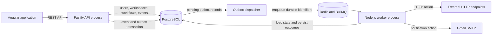

# FlowForge Architecture

FlowForge is a workflow automation platform that receives signed webhook events, evaluates them against versioned workflow definitions, and runs the configured actions asynchronously. Its architecture keeps durable application state in PostgreSQL while using Redis and BullMQ to deliver background work.

## System overview

FlowForge is structured as a modular monolith with two backend runtime processes: an HTTP API and a background worker. They share application modules, business rules, and the same PostgreSQL database. The processes are separated to keep HTTP request handling independent from asynchronous workflow execution; they do not communicate through service-to-service HTTP calls.

PostgreSQL is the source of truth for users, workspaces, workflow definitions and versions, webhook configuration, events, executions, action attempts, and other durable state. Redis and BullMQ provide job delivery, scheduling, and retries; they are not used as a business-data store or cache.

## Backend structure

The backend is organized around product capabilities such as identity, workspaces, workflows, webhooks, events, and executions. Within a capability, responsibilities are separated into layers:

- **Routes and controllers** translate HTTP requests into application calls and map results to explicit response DTOs.
- **Services** coordinate business rules, authorization, and transaction boundaries.
- **Repositories** execute parameterized SQL and map database rows into application types.
- **Adapters** connect application behavior to infrastructure such as BullMQ, HTTP destinations, and email delivery.

The API and worker compose these shared modules at their respective entry points. PostgreSQL access uses `pg` and explicit SQL; database structure changes are managed by ordered migrations.

## Webhook event lifecycle

1. A client sends an event to a configured webhook endpoint. The API enforces request-size limits and reads the raw request bytes.
2. The API checks the webhook timestamp and verifies the HMAC signature against the raw bytes before parsing the JSON body.
3. In one PostgreSQL transaction, the API records the event and durable outbox work. A unique constraint on `(webhook_id, external_event_id)` makes repeated delivery of the same external event idempotent. The event records the workflow version selected when it is accepted.
4. The outbox dispatcher publishes the persisted event identifier to BullMQ. If queue publication is interrupted, pending outbox records remain in PostgreSQL and can be found and dispatched later.
5. A worker loads the event and its pinned workflow version from PostgreSQL, evaluates the workflow, and runs its actions in order.
6. Execution, step, and attempt outcomes are written to PostgreSQL so that workflow history remains available independently of queue state.

## Workflow definitions and execution

Workflow definitions are versioned JSON documents stored in PostgreSQL as JSONB. The API validates definitions against the supported schema before publishing them. Published versions are immutable, and each event and execution is associated with a specific version so later edits do not change the definition used by existing work.

Conditions use JSON Pointer paths to read values from an event payload. Supported operators include existence checks, equality and inequality, numeric comparisons, and containment. Conditions are evaluated deterministically; when the workflow's conditions do not match, its actions are skipped.

Actions run in their configured order. The backend supports logging, notifications, and outbound HTTP requests. Notification delivery can use Gmail SMTP configured for the worker. Outbound HTTP requests apply destination checks, timeouts, response-size limits, and redirect restrictions to reduce server-side request forgery (SSRF) risk.

## Durability and failure handling

The API commits event state and outbox intent to PostgreSQL before queue dispatch. This closes the failure window where an event could be stored but forgotten if the process stops before enqueueing a job. The dispatcher can retry publication from durable outbox records.

BullMQ provides at-least-once job delivery, so a job may be delivered more than once. Workers use durable identifiers, PostgreSQL state transitions, and execution-level coordination to avoid applying the same persisted workflow progress concurrently. External side effects cannot be guaranteed exactly once: if a worker stops after a remote system performs an action but before FlowForge records the response, the outcome may be uncertain. Such attempts are recorded as unknown rather than automatically replayed as though no side effect occurred.

Retryable failures are retried within configured bounds. Permanent failures and exhausted retries are reflected in the durable execution and attempt history. Database transactions remain short and are not held open while waiting for Redis or an external provider.

## Security boundaries

The Angular application is an untrusted API client. The backend validates request data, authenticates users, and checks workspace membership and roles for workspace-scoped operations. Passwords are stored as Argon2id verifiers. Login uses a server-side session represented in the browser by an HttpOnly cookie; state-changing authenticated requests are protected by CSRF validation.

Webhook signatures are checked over the exact raw request bytes using constant-time comparison. Secrets, session tokens, sensitive headers, and full sensitive payloads are not written to application logs. API errors expose stable error codes, safe messages, and a request identifier rather than internal exception details.

The worker treats workflow action configuration and remote responses as untrusted input. In particular, outbound HTTP destination resolution and connection behavior are checked to reduce access to loopback and private network addresses.

## Frontend and API documentation

The Angular frontend uses the REST API for authentication, workspace selection and management, workflow lifecycle operations, webhook configuration, and event and execution history. Authorization remains a backend responsibility regardless of which controls are visible in the UI.

The backend publishes an OpenAPI description for the REST API. In the local development environment, the OpenAPI document and its interactive documentation UI are available for exploring the API contract.
