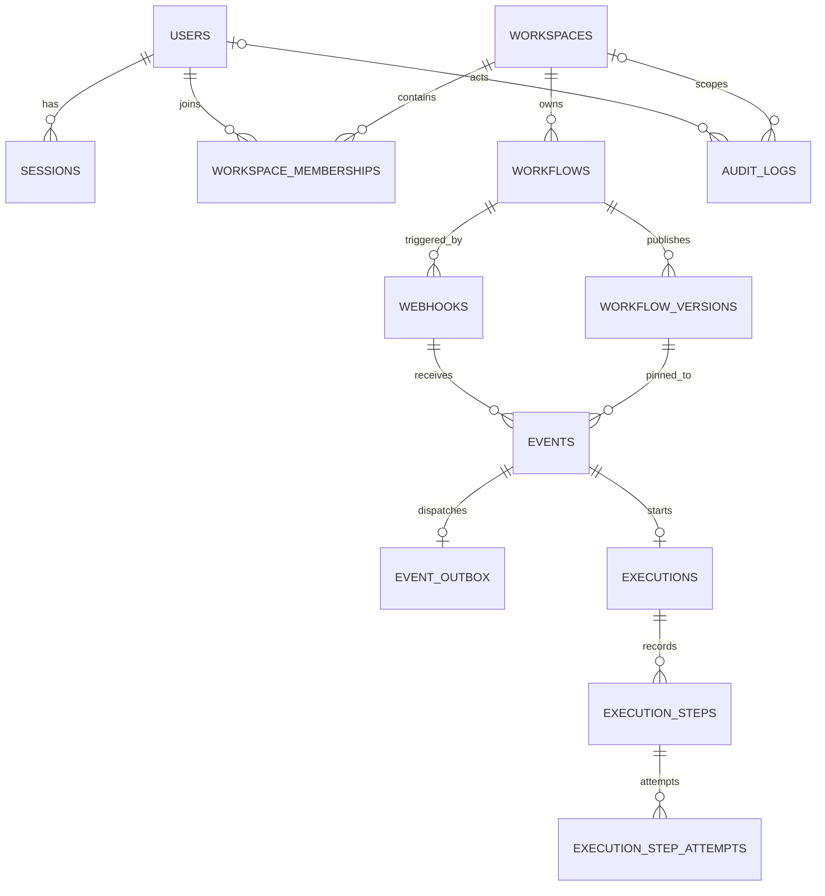

# FlowForge Database Design

FlowForge uses PostgreSQL as the authoritative store for account, workspace, workflow, webhook, event, and execution data. The Node.js backend accesses PostgreSQL through `pg` and parameterized SQL. Schema changes are applied through ordered SQL migrations; the project does not use an ORM.

Redis and BullMQ support asynchronous job delivery, scheduling, and retries. They are not used as a database, cache, or source of truth. Queue messages refer to records persisted in PostgreSQL.

## Data model

The principal tables are:

| Table | Purpose |
| --- | --- |
| `users` | User identity, normalized email, Argon2id password verifier, account status, and timestamps. |
| `sessions` | Hashes of opaque session tokens, their user, and expiration time. The raw cookie token is not stored. |
| `workspaces` | Tenant boundary for workflows and related configuration. |
| `workspace_memberships` | User-to-workspace relationship and role (`OWNER`, `ADMIN`, or `MEMBER`). |
| `workflows` | Workspace-owned workflow identity, draft definition, lifecycle state, and current published version reference. |
| `workflow_versions` | Immutable published workflow definition, its per-workflow version number, JSON Schema version, creator, and creation time. |
| `webhooks` | Webhook-to-workflow configuration, enabled state, encrypted signing secret material, and secret/key version metadata. |
| `events` | Accepted webhook event ID, JSONB payload, receipt time, and the workflow/version selected for processing. |
| `event_outbox` | Durable dispatch intent and publication/reconciliation state for an event. |
| `executions` | Durable processing state for an event, including the workflow version used, timestamps, retry count, and safe failure summary. |
| `execution_steps` | Ordered condition/action outcome for an execution, keyed by the stable step ID in the pinned definition. |
| `execution_step_attempts` | Per-invocation action history, including state, retryability, timestamps, and bounded outcome or failure details. |
| `audit_logs` | Actor, optional workspace, action, target, timestamp, and structured JSONB metadata. |

## Relationships and integrity

UUID primary keys identify records. Foreign keys express ownership and processing relationships, while check constraints restrict valid statuses, roles, lengths, JSONB shapes, and state combinations. These database constraints protect important invariants even when requests or jobs run concurrently.

Workspace-owned workflows and webhook configuration are associated with the same workspace. A composite foreign key prevents a webhook from pointing at a workflow in a different workspace. Workflow current-version references are also constrained to a version belonging to that workflow. A deferred constraint allows a workflow and its first version to be published in one transaction, while an active workflow must have a current version.

Deletion behavior is deliberate. Deleting a user removes their sessions and memberships; creator and audit actor references use `SET NULL` to preserve historical records. Deleting a workspace cascades to its workflows and memberships. Event and execution history uses restrictive references where deletion would otherwise break the record of accepted work or its published definition.

## Versioned workflow definitions

Draft definitions are stored on `workflows`. Publishing inserts a new row in `workflow_versions`; previously published rows are not edited. Each version has a positive `version_number` unique within its workflow and a `schema_version` matching the `schemaVersion` inside its JSONB definition. The current version pointer belongs to the same workflow.

Accepted events and their executions reference the exact workflow version selected for that event. This keeps in-flight processing and historical execution details stable when a later version is published. Composite foreign keys enforce that the event and execution version belongs to the associated workflow.

## Webhook intake and idempotency

Each event has a required external event ID. A unique constraint on `(webhook_id, external_event_id)` makes duplicate deliveries of the same event idempotent, including simultaneous requests. The event stores the JSONB payload and the workflow/version binding needed by the worker.

The API inserts the event and its `event_outbox` record in one PostgreSQL transaction. The outbox has one row per event, enforced by a unique constraint. A partial index over unpublished rows supports dispatcher polling without scanning already published records. This transaction ensures that an accepted event has durable dispatch intent before Redis is involved.

The dispatcher publishes event identifiers to BullMQ and records publication in PostgreSQL. PostgreSQL and Redis cannot commit atomically together, so enqueueing can be duplicated or interrupted. The outbox records publication time; reconciliation metadata includes a dispatch generation and last reconciliation time. Partial indexes support selection of pending and stale dispatch records. Workers reload the event and workflow version from PostgreSQL rather than treating the job payload as authoritative data.

## Execution history and recovery

An event can have at most one execution, enforced by a unique `event_id` on `executions`. The execution is linked to both the event and the workflow version it uses. Each execution has ordered steps with unique `(execution_id, step_id)` and `(execution_id, step_order)` constraints. Action attempts have unique `(execution_step_id, attempt_number)` pairs.

Execution, step, and attempt statuses are constrained to known values. Attempts distinguish `RUNNING`, `SUCCEEDED`, `FAILED`, and `UNKNOWN`. A retryable failure is stored as a failed attempt while the workflow action may be retried by BullMQ. If a worker stops while an external action is still recorded as `RUNNING`, the outcome cannot be known safely; recovery marks it `UNKNOWN` and does not automatically repeat the side effect. Result metadata and failure summaries are bounded and are not intended to store full payloads, response bodies, credentials, or raw provider errors.

The worker uses a PostgreSQL session-level advisory lock scoped to an execution to prevent duplicate jobs from processing the same execution concurrently. This lock is held on a dedicated connection, not inside a long-running transaction. Database transactions cover database changes only; the worker does not wait on Redis or external HTTP/SMTP calls while a transaction is open.

## Indexes and query patterns

Unique constraints create indexes for identity and idempotency lookups. Additional indexes support common list and recovery paths, including:

- sessions by user and by expiration time;
- memberships by user;
- workflows by workspace and creation time;
- webhooks by workspace and workflow;
- events by webhook and receipt time;
- executions by workflow and creation time;
- pending outbox rows and published rows eligible for reconciliation;
- execution steps by execution/order and attempts by step/attempt number through their uniqueness constraints.

The schema uses `TIMESTAMPTZ` for time-based data and PostgreSQL-generated timestamps for creation and update fields. Migration files are ordered and tracked in `schema_migrations`, allowing each database to apply pending schema changes without relying on application startup side effects.
